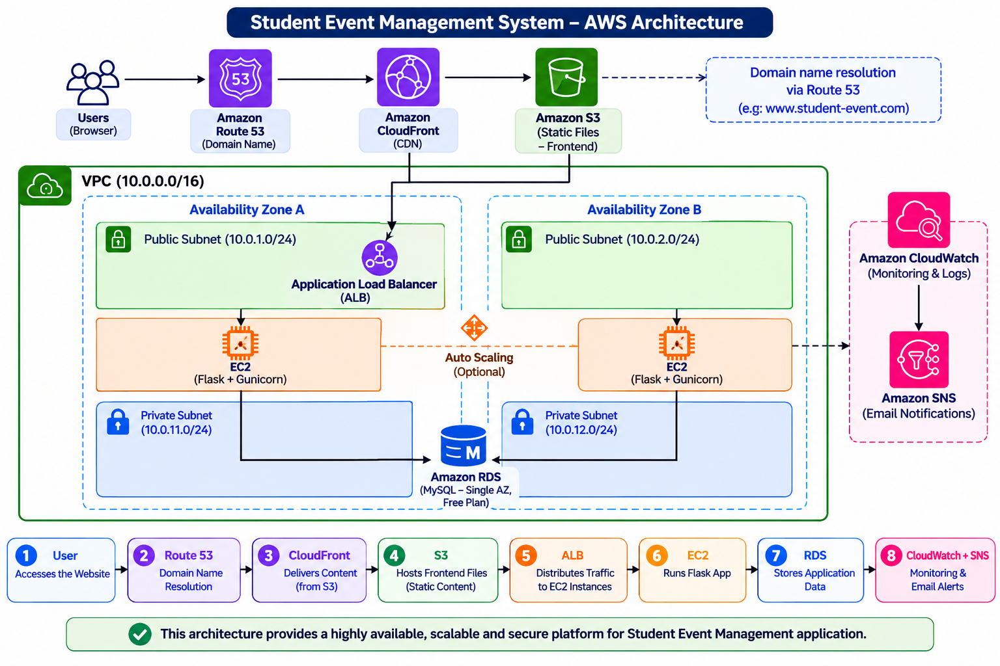

# Student Event Management System – AWS Architecture

## 1. Project Overview

The Student Event Management System is a cloud-based web application designed to help students view available events and register for different college activities online.

The main objective of this project is to design a secure, scalable, cost-effective and highly available application infrastructure using Amazon Web Services (AWS).

Students can access the website, view event details and register by providing their personal information.

The application uses a three-tier architecture consisting of the Presentation Layer, Application Layer and Database Layer.

### Project Objectives

- Provide online student event registration.
- Host frontend files using Amazon S3.
- Distribute website content using CloudFront.
- Run the backend application using Amazon EC2.
- Distribute incoming traffic using Application Load Balancer.
- Store student registration details in Amazon RDS MySQL.
- Monitor application performance using CloudWatch.
- Send email notifications using SNS.
- Improve application availability and scalability.

---

## 2. Real-World Problem Statement

Colleges and educational institutions frequently organize technical events, workshops, coding competitions and other student activities.

Managing registrations manually creates several challenges.

### Problem 1 – Manual Registration

Students may need to register through paper forms or manual processes.

**Solution:** Provide an online registration platform.

### Problem 2 – Managing Student Data

Managing student registration details manually can be difficult.

**Solution:** Store student details in Amazon RDS MySQL.

### Problem 3 – Application Traffic

When many students access the website simultaneously, a single application server may experience high traffic.

**Solution:** Use Application Load Balancer and multiple EC2 instances.

### Problem 4 – Website Performance

Delivering static website files directly from the application server can increase server workload.

**Solution:** Store frontend files in Amazon S3 and distribute them through CloudFront.

### Problem 5 – Security

The database should not be directly accessible from the public internet.

**Solution:** Use private database networking and Security Groups.

### Problem 6 – Monitoring

Administrators need to identify application and infrastructure problems.

**Solution:** Use CloudWatch monitoring and SNS email notifications.

---

## 3. AWS Architecture Diagram

The architecture follows a three-tier AWS deployment model.

**Architecture Image:**

### Architecture Components

- Amazon Route 53 – Domain Name Resolution
- Amazon CloudFront – Content Delivery Network
- Amazon S3 – Frontend Static File Storage
- Amazon VPC – Network Isolation
- Public and Private Subnets – Network Segmentation
- Application Load Balancer – Traffic Distribution
- Amazon EC2 – Backend Application Hosting
- Python Flask – Backend Framework
- Gunicorn – Application Server
- Amazon RDS MySQL – Database Storage
- Auto Scaling – Application Capacity Management
- Amazon CloudWatch – Monitoring
- Amazon SNS – Email Notifications

---

## 4. Three-Tier Architecture

### Tier 1 – Presentation Layer

The presentation layer handles the website interface accessed by students.

Components:

- Amazon Route 53
- Amazon CloudFront
- Amazon S3

Responsibilities:

- Domain name resolution.
- Deliver frontend content.
- Store HTML, CSS and JavaScript files.
- Provide website access to students.

### Tier 2 – Application Layer

The application layer processes student registration requests.

Components:

- Application Load Balancer
- Amazon EC2
- Python Flask
- Gunicorn

Responsibilities:

- Receive registration requests.
- Process student information.
- Validate registration details.
- Communicate with the database.
- Return registration results.

### Tier 3 – Database Layer

The database layer stores application information.

Component:

- Amazon RDS MySQL

Responsibilities:

- Store student details.
- Maintain event registration records.
- Retrieve registration information.
- Manage application data.

---

## 5. Project Workflow

1. Students access the website through a browser.
2. Amazon Route 53 handles domain name resolution.
3. CloudFront delivers the frontend content.
4. Amazon S3 provides static website files.
5. Students select an event and submit the registration form.
6. Application Load Balancer forwards requests to EC2.
7. EC2 runs the Python Flask application using Gunicorn.
8. Flask processes the registration request.
9. Student information is stored in Amazon RDS MySQL.
10. The application returns a registration success response.

---

## 6. Cost Optimization Strategy

The objective is to use AWS services efficiently while avoiding unnecessary infrastructure costs.

| Requirement          | Cost-conscious approach      |
| -------------------- | ---------------------------- |
| Frontend hosting     | Amazon S3                    |
| Content delivery     | CloudFront                   |
| Backend hosting      | Right-sized EC2              |
| Traffic distribution | ALB                          |
| Database             | Right-sized RDS              |
| Monitoring           | CloudWatch                   |
| Notifications        | SNS                          |
| Storage              | Right-sized EBS              |
| Access management    | IAM roles                    |
| Scaling              | Auto Scaling based on demand |

Note: Actual costs depend on AWS region, usage, service configuration and current pricing. ALB, CloudFront and RDS can incur charges even for small projects.

---

## 7. Security Implementation

Security is an important part of the architecture.

### VPC

Provides an isolated networking environment.

### Public Subnets

Used for internet-facing components such as the Application Load Balancer.

### Private Subnets

Used to isolate backend and database resources where configured.

### Security Groups

Control inbound and outbound traffic.

### IAM

Provides controlled access to AWS resources.

### RDS Security

Database access should be restricted to the application server security group.

---

## 8. Monitoring and Alerting

### Amazon CloudWatch

Used to monitor:

- EC2 CPU utilization.
- Instance metrics.
- Application logs.
- Infrastructure performance.

### Amazon SNS

Used to send email notifications when configured CloudWatch alarms are triggered.

---

## 9. Major Problems Faced During Implementation

During AWS practical implementation, several configuration and application issues can occur.

### Problem 1 – EC2 SSH Connection

**Issue:** Unable to connect to EC2 using SSH.

**Troubleshooting:**

- Verify the EC2 instance state.
- Check the public IP address.
- Verify the SSH key pair.
- Allow inbound SSH port 22 from My IP.
- Check network connectivity.

### Problem 2 – Flask Application Port Already in Use

**Issue:** Flask application cannot start because port 5000 is already in use.

**Troubleshooting:**

- Check processes listening on port 5000.
- Identify the existing Python process.
- Stop the unnecessary process.
- Restart the Flask application.

### Problem 3 – Flask Application Stops After SSH Disconnect

**Issue:** Application works while connected through SSH but becomes unavailable after closing the terminal.

**Solution:**

- Install Gunicorn.
- Configure Gunicorn to run the Flask application.
- Configure a systemd service for persistent application execution.

### Problem 4 – RDS Connection Failure

**Issue:** EC2 cannot connect to the RDS database.

**Troubleshooting:**

- Verify RDS status.
- Check the database endpoint.
- Verify MySQL port 3306.
- Allow the EC2 security group as the source in the RDS security group.
- Install a MySQL client on EC2.
- Verify database username and password.

### Problem 5 – Application Load Balancer Health Check

**Issue:** ALB target instances may show unhealthy status.

**Troubleshooting:**

- Verify EC2 instance status.
- Check the target group port.
- Verify the health check path.
- Check application availability.
- Verify EC2 and ALB security group rules.

---

## 10. Troubleshooting and Lessons Learned

The project provides practical experience in:

- AWS EC2 instance configuration.
- VPC and subnet configuration.
- Security Group troubleshooting.
- S3 frontend hosting.
- CloudFront content delivery.
- Application Load Balancer configuration.
- Flask and Gunicorn deployment.
- RDS MySQL connectivity.
- CloudWatch monitoring.
- SNS email notifications.

---

## 11. Future Improvements

The application can be enhanced with:

- Student login and authentication.
- Admin dashboard.
- Event creation and management.
- Event registration confirmation.
- Email notifications for students.
- Docker containerization.
- Jenkins CI/CD pipeline.
- Auto Scaling configuration.
- Automated database backups.
- HTTPS using SSL/TLS certificates.

---

## 12. Conclusion

The Student Event Management System demonstrates how AWS services can be integrated to build a cloud-based web application.

By combining Amazon S3, CloudFront, EC2, Application Load Balancer, RDS, VPC, CloudWatch and SNS, the project demonstrates cloud infrastructure design, application deployment, networking, security and monitoring.

This project provides practical exposure to AWS Cloud Computing.
